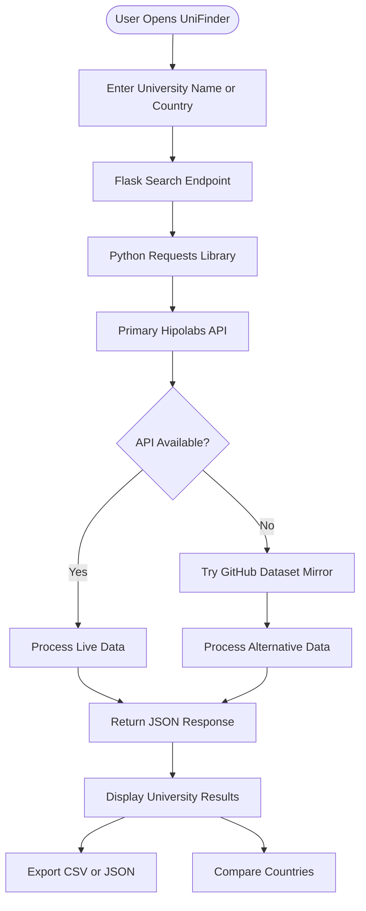

 
<div align="center">

# 🌍 UniFinder

### Discover Universities. Explore Opportunities. Build Your Future.


<p>
  
  
  
  
</p>

<p>
  
  
  
</p>

**A modern university discovery platform built with Python and Flask.**

[Explore the Repository](https://github.com/hassan1450/UniFinder) · [Report an Issue](https://github.com/hassan1450/UniFinder/issues)

</div>

---

## ✨ Overview

**UniFinder** is a Python and Flask-based web application that helps students discover universities around the world through a simple and responsive interface.

It retrieves real-time university information using Python's `requests` library and the open-source **Hipolabs University API**. Users can search institutions by name or country, compare university counts across multiple countries, and export results for further use.

The application also supports an alternative GitHub data source when the original API is unavailable, helping maintain service availability without relying on hardcoded sample results.

## 🚀 Key Features

<table>
<tr>
<td width="50%">

### 🔎 Global University Search
Search universities by institution name, country, or both.

</td>
<td width="50%">

### 🌐 Live API Integration
Retrieve current university records from public data sources.

</td>
</tr>
<tr>
<td width="50%">

### 📊 Country Comparison
Compare university counts across 2–4 different countries.

</td>
<td width="50%">

### 📥 Data Export
Download search results in CSV and JSON formats.

</td>
</tr>
<tr>
<td width="50%">

### 🔄 Alternative Data Source
Use the GitHub dataset mirror if the primary API is unavailable.

</td>
<td width="50%">

### 📱 Responsive Interface
Access the website on desktop and mobile devices.

</td>
</tr>
</table>

## 🛠️ Technology Stack

| Technology | Purpose |
|---|---|
| **Python** | Core application logic and API communication |
| **Flask** | Backend web framework and API endpoints |
| **Requests** | Fetching university data from external sources |
| **HTML5** | Website structure |
| **CSS3** | Styling and responsive layouts |
| **JavaScript** | Dynamic search and interactive features |
| **JSON** | University data exchange and processing |
| **CSV** | Exporting university records |

## 🔗 Data Source

UniFinder uses the open-source Hipolabs University Dataset.

- **Primary API:** https://universities.hipolabs.com/search
- **GitHub Repository:** https://github.com/Hipo/university-domains-list
- **API Authentication:** No API key required.

The application tries the primary API first and uses the GitHub mirror as a fallback when necessary.

## ⚙️ How It Works



## 📂 Project Structure

```text
UniFinder/
│
├── app.py
├── university_api.py
├── requirements.txt
├── README.md
├── .gitignore
│
├── templates/
│   ├── base.html
│   ├── index.html
│   └── about.html
│
├── static/
│   ├── css/
│   │   └── style.css
│   ├── js/
│   │   └── script.js
│   └── images/
│
└── tests/
    └── test_university_api.py
```

## 💻 Installation & Setup

### 1. Clone the Repository

```bash
git clone https://github.com/hassan1450/UniFinder.git
```

### 2. Navigate to the Project

```bash
cd UniFinder
```

### 3. Create a Virtual Environment

```bash
py -m venv .venv
```

### 4. Activate the Environment

**Windows PowerShell:**

```powershell
.\.venv\Scripts\Activate.ps1
```

**Windows Command Prompt:**

```cmd
.venv\Scripts\activate.bat
```

### 5. Install Dependencies

```bash
python -m pip install -r requirements.txt
```

### 6. Run the Application

```bash
python app.py
```

### 7. Open in Your Browser

```text
http://127.0.0.1:5000
```

🎉 **UniFinder is now running locally!**

## 📡 API Documentation

| Method | Endpoint | Description |
|---|---|---|
| GET | `/api/search?name=Oxford` | Search by university name |
| GET | `/api/search?country=Canada` | Search by country |
| GET | `/api/search?name=Oxford&country=United%20Kingdom` | Search by name and country |
| POST | `/api/compare` | Compare 2–4 countries |
| GET | `/api/export?country=Canada&type=csv` | Export results as CSV |
| GET | `/api/export?country=Canada&type=json` | Export results as JSON |

### Example API Request

```http
GET /api/search?name=University%20of%20Toronto&country=Canada
```

### Example JSON Response

```json
{
  "success": true,
  "total": 1,
  "universities": [
    {
      "name": "University of Toronto",
      "country": "Canada",
      "web_pages": [
        "https://www.utoronto.ca/"
      ],
      "domains": [
        "utoronto.ca"
      ]
    }
  ]
}
```

*Note: This is an illustrative response. Actual records and totals depend on the live data source.*

## 🧪 Run Tests

UniFinder uses Python's built-in `unittest` framework.

The test suite mocks API responses, so tests can run without an active internet connection.

```bash
python -m unittest discover -s tests -v
```

## 🎯 Project Objectives

- Practice real-world API integration using Python.
- Understand HTTP requests and JSON data processing.
- Build a functional web application using Flask.
- Work with external datasets and alternative data sources.
- Implement data comparison and file export functionality.
- Apply Git and GitHub version control practices.

## 🔮 Future Improvements

- Advanced university filtering and sorting.
- University details and additional information.
- Save favourite universities.
- More detailed country-level analytics.
- Improved search experience and pagination.

## 👨‍💻 Author

<div align="center">

### NOOR UL HASSAN

**Software Developer | MERN Stack | Web & Mobile Development**

Final-Year BSIT Student — Bahria University

<p>
  <a href="https://github.com/hassan1450">
    
  </a>
  <a href="https://www.linkedin.com/in/hassan-awan-9a0415386/">
    
  </a>
</p>

</div>

---

<div align="center">

### 🌍 Explore the World of Universities with UniFinder

*Built with Python, Flask, and a passion for learning.*

**If you find this project useful, consider giving it a ⭐ on GitHub!**

</div>
